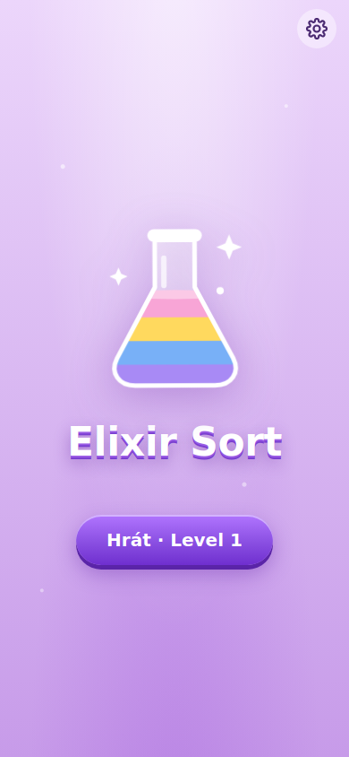
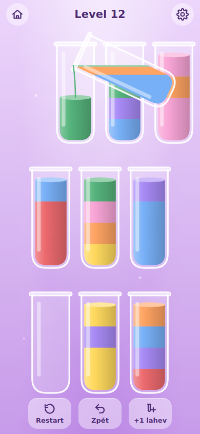
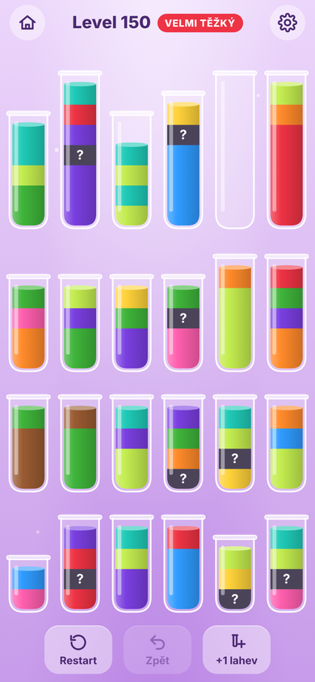
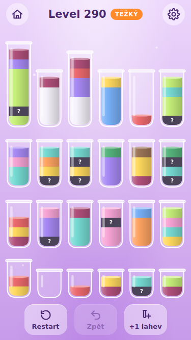

# Elixir Sort

Offline PWA hra na třídění barev (water sort) podle mobilní hry Magic Sort. Mechaniky jsou převzaté, grafika, název i texty jsou vlastní. Žádné reklamy, mince ani backend.

| Úvod | Přelévání | Level 150 | iPhone SE, level 290 |
| --- | --- | --- | --- |
|  |  |  |  |

Zadání je v [SPEC.md](SPEC.md), kontext pro Claude Code v [CLAUDE.md](CLAUDE.md).

## Rychlý start

Potřebuješ **Node 22.18+** (testy běží přímo v Node přes vestavěné odstraňování typů).

```bash
npm install
npm test          # 44 testů, ~20 s (ověří i řešitelnost levelů 1–300)
npm run dev       # vývojový server, vypíše i adresu v lokální síti
```

Na iPhonu ve stejné Wi‑Fi otevři adresu `Network:`, kterou vypíše `npm run dev` (např. `http://192.168.1.20:5173`). Hra jde hrát hned. Instalace na plochu a offline režim ale potřebují HTTPS (viz [Testování na iPhonu](#testování-na-iphonu)).

| Příkaz | Co dělá |
| --- | --- |
| `npm run dev` | vývojový server s hot reloadem (i pro telefon v síti) |
| `npm run build` | typová kontrola + produkční build do `dist/` (včetně `sw.js`) |
| `npm run preview` | servíruje `dist/` (i v síti) |
| `npm test` | všechny testy (`node --test`) |
| `npm run typecheck` | typová kontrola aplikace i testů/skriptů |
| `npm run levels -- 1 300` | tabulka levelů: parametry, obtížnost, čas generování |
| `npm run icons` | znovu vygeneruje PNG ikony (Python + Playwright) |

Debug režim: přidej do adresy `?debug`. Vpravo nahoře se objeví FPS, po ťuknutí na něj se rozbalí skok na level, výpis řešení s nápovědou a automatické dohrání levelu.

## Stav

Hotové a ověřené testy a během produkčního buildu v Chromiu v rozlišení iPhonu 14, 14 Pro a SE:

- Pravidla, Zpět, +1 lahev, Restart, uzavírání lahví, výhra, bezvýchodná situace
- Lahve různé výšky (2–8), barva přes více lahví, skryté barvy od levelu 31
- Nekonečný deterministický generátor; levely 1–300 ověřeně řešitelné přes engine hry; generování typicky 40–70 ms na PC (maximum 90 ms, jednou při zátěži 279 ms) ve Web Workeru
- Rozložení: 24 lahví v nejhorším případě 40,5 pt na iPhonu SE a 47,5 pt na iPhonu 14, stránka se neposouvá
- Animace: zvednutí, let nad cílovou lahev, fyzikální náklon s vodorovnou hladinou, proud, zátka se zábleskem a jiskrami, rozlití barvy při odkrytí, zatřesení, konfety přes celou obrazovku
- Lahve v klidu se kopírují z předkresleného plátna: při 24 lahvích a 3 současných přelitích kleslo vykreslení snímku v softwarovém Chromiu z 13–18 ms na 8,5–11 ms a snímků nad 20 ms z 6–88 na 0–9 za 8 s
- Zvuky přes Web Audio, tutoriál s rukou (levely 1–3), tip ke skrytým barvám, banner těžkých levelů
- Ukládání rozehrané hry včetně historie tahů, nastavení, statistik
- Offline: po prvním načtení jde hra spustit, vygenerovat nový level i dohrát bez sítě; první vykreslení z cache 82 ms na PC
- Aktualizace: nová verze uprostřed levelu čeká a přepne se až na úvodní obrazovce
- Build 31 kB gzip bez ikon (limit 150 kB)
- Dockerfile + nginx: image se sestaví včetně testů a servíruje správné MIME typy a cache hlavičky; příklad pro k3s (`deploy/k8s.yaml`) nasazený není

**Co jde ověřit jen na skutečném iPhonu** (vše výše běželo v Chromiu, ne v Safari):

1. 60 fps na iPhonu 14 a generování pod 500 ms. Měření na PC dává jen porovnání, ne absolutní hodnoty.
2. Zvuky: odemknutí prvním dotykem a obnovení po návratu z pozadí.
3. Skutečné safe areas. V Chromiu jsem jen přepsal CSS proměnné na hodnoty notche a Dynamic Islandu, `env()` z iOS jsem neměl.
4. Instalace na plochu, spuštění z plochy v režimu letadlo, mazání dat systémem.
5. Pocitová obtížnost – křivka je nastavená podle měření, ale potřebuje dohrát pár desítek levelů.

## Testování na iPhonu

PWA (instalace a offline) vyžaduje HTTPS. Možnosti:

- **Cloudflare Tunnel** (nejrychlejší): `npm run build && npm run preview`, pak `cloudflared tunnel --url http://localhost:4173` a otevři vypsanou `https://….trycloudflare.com` adresu v Safari.
- **Tvůj k3s**: `docker build -t elixir-sort .`, nahraj do registry a nasaď podle [deploy/k8s.yaml](deploy/k8s.yaml) (Ingress s TLS).
- Jen hraní bez instalace: `npm run dev` a adresa v lokální síti (HTTP stačí).

Kontrola na iPhonu (akceptační kritéria ze zadání):

- [ ] Sdílet → Přidat na plochu, spustit z plochy, zapnout režim letadlo → hra jde hrát
- [ ] `?debug` → FPS při přelévání na levelu 150+ drží ~60 (120 na Pro)
- [ ] Zvuky po prvním ťuknutí, po návratu z pozadí fungují dál
- [ ] Nic pod notchem / Dynamic Islandem / domácím indikátorem
- [ ] Zavřít appku uprostřed levelu → po spuštění pokračuje i se Zpět
- [ ] Po nasazení nové verze se aktualizace projeví až na úvodní obrazovce

## Struktura

```
src/
  core/      pravidla (rules.ts), stav hry + Zpět/Restart (game.ts), křivka obtížnosti (config.ts), PRNG
  solver/    kompaktní reprezentace (board.ts), generátor levelů, solver + měření obtížnosti
  worker/    Web Worker a klient s cache a předgenerováním dalšího levelu
  render/    rozložení lahví, Canvas renderer, paleta, částice, konfety
  ui/        řadič hrací plochy a animací (board.ts), ukládání, texty, debug panel
  audio/     syntetické zvuky
  main.ts    obrazovky, panely, tok aplikace
  sw-template.js   šablona service workeru (sw.js generuje vite.config.ts)
scripts/     report levelů, generování ikon
deploy/      nginx.conf, k8s.yaml
```

## Ladění obtížnosti

Vše je v [src/core/config.ts](src/core/config.ts):

- `BANDS` – pásma levelů: počet barev, lahví, prázdných lahví, rozsah kapacit, skryté jednotky. To je hrubá obtížnost.
- `pick` v pásmu – generátor vyrobí 8 kandidátů, seřadí je podle naměřené obtížnosti a vezme ten na daném kvantilu (0 = nejlehčí, 1 = nejtěžší). To je jemná obtížnost.
- Po každé změně generátoru nebo křivky zvyš `GENERATOR_VERSION` (rozehraný level staré verze se zahodí) a pusť `npm test` a `npm run levels`.

## Odchylky od zadání

- **Uzavření lahve se skrytou jednotkou:** plná jednobarevná lahev se uzavře, i když v ní je neodkrytá jednotka, a ta se při tom odkryje. Podle původního pravidla by skrytá jednotka na dně lahve, ze které se už nepřelévá, zablokovala výhru.
- **Generátor:** místo náhodného rozdání + solveru staví levely pozpátku z vyřešeného stavu. Náhodné rozdání s různými kapacitami je u velkých levelů většinou neřešitelné. Řešitelnost je zaručená konstrukcí a test ji ověřuje přehráním řešení v enginu hry.
- **Obtížnost:** vybírá se kandidát podle pořadí (`pick`), ne podle cílového podílu prohraných her. Náhodný hráč velké levely nedohraje nikdy, takže tahle metrika u nich nerozlišovala.
- **Solver:** best-first s heuristikou (prohledávání do hloubky se na velkých levelech ztrácelo). Používá se pro nápovědu v tutoriálu a debug.
- **Testy:** `node:test` místo Vitestu – bez závislostí, běží rovnou v Node 22.
- **PWA:** vlastní service worker a malý plugin ve `vite.config.ts` místo `vite-plugin-pwa`. Precachuje všechny soubory buildu, aktualizace čeká na úvodní obrazovku.
- **Náklon:** počítá se z objemu tekutiny tak, aby hladina právě dosahovala na hrdlo, takže je v rozsahu ~30–95° místo pevných 60–85°.
- **Přelití:** 660–780 ms podle množství tekutiny místo pevných 700 ms.
- **Generování při selhání workeru:** když Web Worker nejde spustit, level se vygeneruje na hlavním vlákně. V běžném provozu se to neděje, je to jen pojistka, aby hra nezůstala bez levelu.
- **Prázdné lahve:** všechna pásma mají 2 náhradní lahve, jedna z nich bývá na začátku částečně naplněná (jako na snímku originálu).
- **+1 lahev na iPhonu SE:** s 25. přidanou lahví a kapacitami až 8 má lahev v nejhorším případě 39 pt. Zadání požaduje 40 pt při 24 lahvích, to platí.
- **Předkreslení:** lahve v klidu jsou předkreslené celé včetně tekutiny. Lahve v animaci (nakloněné, plnící se, se zátkou ve vzduchu) se kreslí živě.
- **Nedělal jsem:** vysoké lahve po stranách přes víc řad (volitelné v zadání), lint (ESLint by porušil pravidlo o dev závislostech v CLAUDE.md; `tsc` se `strict` a `noUnused*` kontroluje část téhož).

## Pokračování s Claude Code

Otevři složku ve VS Code a spusť Claude Code. [CLAUDE.md](CLAUDE.md) mu dá kontext. Další krok je projít [kontrolu na iPhonu](#testování-na-iphonu) a nahlásit, co nesedí (FPS, zvuky, safe areas, obtížnost).
